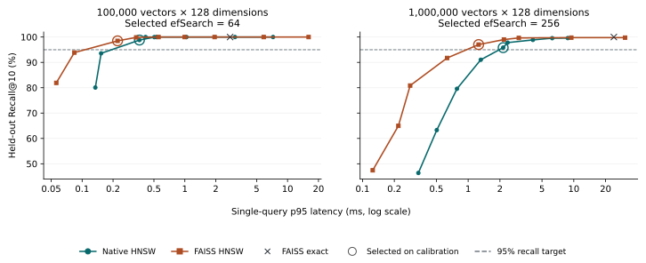

# Native vector search and FAISS on CPU

## High recall at 100K and 1M vectors

On one million 128-dimensional vectors, native HNSW recovered **95.82%** of the exact top ten at **2.15 ms p95** and **659 queries/s**. FAISS HNSW recovered **97.03%** at **1.26 ms p95** and **1,103 queries/s**. Each graph used the smallest tested search width that reached the 95% calibration target. Test Recall@10, latency and throughput use 512 separate queries.

| Vectors | Index | efSearch | Test Recall@10 | p50 µs | p95 µs | Batch queries/s | Core MiB | Peak RSS MiB | Build s |
| ---: | --- | ---: | ---: | ---: | ---: | ---: | ---: | ---: | ---: |
| 100K | Native HNSW | 64 | 98.81% | 249 | 361 | 3,828 | 68.3 | 169.5 | 18.95 |
| 100K | FAISS HNSW | 64 | 98.50% | 173 | 221 | 5,857 | 68.7 | 174.8 | 13.20 |
| 100K | FAISS flat | — | 100.00% | 2,173 | 2,758 | 465 | 48.8 | 155.0 | 0.02 |
| 1M | Native HNSW | 256 | 95.82% | 2,058 | 2,145 | 659 | 683.0 | 1,028.3 | 812.30 |
| 1M | FAISS HNSW | 256 | 97.03% | 802 | 1,256 | 1,103 | 686.8 | 1,222.4 | 387.35 |
| 1M | FAISS flat | — | 100.00% | 21,387 | 23,952 | 49 | 488.3 | 1,010.0 | 0.62 |

At **100K**, both engines selected width 64. Calibration recall was 98.55% for native and 98.52% for FAISS. At **1M**, both engines selected width 256. Calibration recall was 97.66% for native and 97.70% for FAISS. At the selected widths, the native trace returned the same ordered IDs as ordinary search for every test query at each size and recorded zero exact-scan fallbacks.

At 1M, native HNSW delivered 13.4× the batch throughput of exhaustive FAISS, using an additional 194.7 MiB of index storage. FAISS HNSW delivered 1.68× the native graph's throughput at its selected setting. Out of 512 test queries, native returned all ten neighbors on 388 and missed all ten on 8. The corresponding FAISS HNSW counts were 398 and 2.

On that same native 1M graph, reducing efSearch from 256 to 128 changed test recall from 95.82% to 91.04% and p95 from 2.15 to 1.32 ms. Both settings used the same 683.0 MiB index.



### Measurement and reproduction

- **Data and ground truth.** Seed 42 generates the same synthetic corpus for each backend at a given size. The generator draws 64 cluster centers with Gaussian coordinates of standard deviation 2. For each float32 vector, it picks a center uniformly and adds independent standard Gaussian noise. Exhaustive FAISS IndexFlatL2 supplies the reference IDs. A separate exhaustive pass with the native double-precision accumulator recovered all 15,360 FAISS reference IDs across the test and calibration queries at both sizes. Test Recall@10 divides the number of recovered IDs by 5,120. The measurements describe this clustered workload.
- **Calibration.** Both HNSW implementations received identical rows, squared L2, M = 24, efConstruction = 120, and one build thread. Each graph was built once and reused. The runner used 256 additional queries to select among efSearch = 16, 32, 64, 128, 256, 512, 1,024, 2,048 and 4,096 in ascending order. It selected the first setting with calibration Recall@10 ≥ 95% before timing or scoring test queries. Implementations can produce different graphs from the same build parameters.
- **Timing.** Latency measures 512 warmed, individual Python search calls. Throughput measures eight consecutive 64-query batches and uses the median elapsed time of five complete passes. Search, construction and library thread limits were set to one. Timing includes binding and result materialization. The width sweep ran from narrow to wide.
- **Memory.** Core MiB covers float32 vectors and the main graph arrays. Native reports allocated vector, offset and link storage. FAISS counts vector payload and the used entries in its level, offset and neighbor arrays. Allocator slack and query scratch space can differ. Peak RSS is the worker's lifetime high-water mark up to that row, including the runtime, source matrix, build scratch and calibration searches. Each engine and shape ran in a fresh process.
- **Environment.** Apple M2 with 8 GiB RAM, macOS 26.0.1, Apple Clang 17 release build (`-O3`, NEON), Python 3.12.11, NumPy 2.3.4 and faiss-cpu 1.16.0. The native engine ran the graph implementation from commit `f15d75e`. FAISS ran its CPU IndexHNSWFlat. Each engine and size had one build and one data seed. The raw records include per-query hit-count histograms and measurements for every width. [High-recall data](high_recall.jsonl)

From the repository root, set up the benchmark environment with Python 3.12 and a C++20 compiler.

```sh
python3.12 -m venv .venv
. .venv/bin/activate
python -m pip install -r benchmarks/requirements.txt
make bindings PYTHON=python
```

Run the high-recall sweep with a new output filename for each run.

```sh
PYTHONPATH=build python benchmarks/compare.py \
  --rows 100000 1000000 --dims 128 --engines faiss-flat native-hnsw faiss-hnsw \
  --M 24 --efConstruction 120 --efSearch 16 32 64 128 256 512 1024 2048 4096 \
  --calibration-queries 256 --recall-target 0.95 --queries 512 --batch-size 64 \
  --threads 1 --repeats 5 --seed 42 --output my-high-recall.jsonl
```

Run `PYTHONPATH=build python benchmarks/test_compare.py` to check the calibration split and both backends against a small exhaustive NumPy reference. To redraw the figure, install Matplotlib (the published figure uses 3.10.3) and run `python benchmarks/plot_recall.py my-high-recall.jsonl --output my-high-recall.svg`.

## Reproduce the matrix

With the benchmark environment active, run the original sparse matrix from the repository root.

```sh
PYTHONPATH=build python benchmarks/compare.py --output my-run.jsonl
```

The default matrix is the Cartesian product of 10K, 100K and 1M rows with 32, 128 and 384 dimensions. Each shape runs native exact, native HNSW, FAISS IndexFlatL2 and FAISS IndexHNSWFlat. Output appends one JSON record per completed measurement. Use a fresh filename for a new run. A smaller subset or a different graph setting can be selected with the same script.

```sh
PYTHONPATH=build python benchmarks/compare.py --rows 10000 --dims 128 --M 16 --efConstruction 100 --efSearch 64
```

## Protocol

- **Data** uses float32 Gaussian noise around 64 random centers. A seed of 42 plus the shape initializes separate streams for centers, corpus rows and 64 held-out queries. Every backend regenerates the identical data in bounded chunks. Times exclude generation and model inference.
- **Graph settings** for the scale matrix are M = 4, efConstruction = 16 and efSearch = 32. This deliberately small graph makes the memory and recall costs of sparse connections visible. The native API defaults at construction are M = 16 and efConstruction = 100.
- **Recall@10** compares row IDs with FAISS IndexFlatL2 exhaustive search on the same query batch. Flat FAISS scores its own reference at 1 by definition. An independent NumPy oracle and native scalar tests verify the engine separately.
- **Latency** times one warmed Python search call per query, including binding and result materialization. p50 and p95 summarize those 64 individual calls. **Throughput** uses the median of three timed batches of all 64 queries following a warm-up. Construction and queries both use one thread, and BLAS/OpenMP thread counts are constrained. The original benchmark supports a separate parallel-batch experiment.
- **Build time** starts with a populated, resident NumPy matrix and includes copying the rows, native validation where applicable and graph construction. Search timing excludes loading and building. These measurements represent one build per configuration.
- **Memory** in the table is peak process RSS, covering input, index, Python runtime and transient allocations over the worker's lifetime. Each index runs in its own process. The raw records also include the RSS change across construction with the input still alive. On this 8 GiB Mac, compression and paging can yield a negative change. Peak RSS and exact vector payload answer different questions.
- **Environment** was arm64 macOS 26.0.1, Apple Clang 17 with `-O3`, Python 3.12.11, NumPy 2.3.4 and faiss-cpu 1.16.0. Native runs selected NEON and FAISS used its CPU index classes. The largest shape was rerun for all four engines with compilation finished, after a competing build affected the first FAISS measurement. The table and raw data use that repeat for all four entries. Treat timings, particularly under memory pressure, as observations from this host. The data, parameters, versions, thread counts, dispatch information and unrounded results are recorded in [results.jsonl](results.jsonl).

## Results

### 10,000 vectors

| Dimensions | Engine | Recall@10 | p50 µs | p95 µs | Batch queries/s | Peak MiB | Build s |
| ---: | --- | ---: | ---: | ---: | ---: | ---: | ---: |
| 32 | native-flat | 1.000 | 78.3 | 81.9 | 12,996 | 65.4 | 0.0003 |
| 32 | faiss-flat | 1.000 | 31.4 | 49.4 | 36,919 | 65.5 | 0.0007 |
| 32 | native-hnsw | 0.631 | 8.4 | 11.8 | 141,802 | 65.7 | 0.0583 |
| 32 | faiss-hnsw | 0.614 | 8.3 | 13.6 | 160,284 | 65.7 | 0.0585 |
| 128 | native-flat | 1.000 | 272.7 | 286.5 | 3,684 | 74.1 | 0.0010 |
| 128 | faiss-flat | 1.000 | 96.8 | 108.4 | 9,598 | 74.0 | 0.0009 |
| 128 | native-hnsw | 0.497 | 12.0 | 16.7 | 94,245 | 74.1 | 0.0966 |
| 128 | faiss-hnsw | 0.503 | 10.2 | 15.2 | 127,670 | 74.5 | 0.0691 |
| 384 | native-flat | 1.000 | 881.4 | 895.6 | 1,135 | 102.5 | 0.0031 |
| 384 | faiss-flat | 1.000 | 302.1 | 352.5 | 3,391 | 102.3 | 0.0027 |
| 384 | native-hnsw | 0.438 | 22.0 | 31.9 | 46,777 | 102.7 | 0.2098 |
| 384 | faiss-hnsw | 0.412 | 12.3 | 16.9 | 99,501 | 102.5 | 0.1003 |

### 100,000 vectors

| Dimensions | Engine | Recall@10 | p50 µs | p95 µs | Batch queries/s | Peak MiB | Build s |
| ---: | --- | ---: | ---: | ---: | ---: | ---: | ---: |
| 32 | native-flat | 1.000 | 748.4 | 767.0 | 1,334 | 88.7 | 0.0026 |
| 32 | faiss-flat | 1.000 | 251.1 | 265.4 | 4,004 | 88.7 | 0.0016 |
| 32 | native-hnsw | 0.345 | 10.3 | 12.1 | 116,895 | 92.9 | 0.6768 |
| 32 | faiss-hnsw | 0.394 | 9.9 | 14.1 | 127,163 | 93.9 | 0.6527 |
| 128 | native-flat | 1.000 | 2,751.6 | 3,041.5 | 355 | 162.2 | 0.0105 |
| 128 | faiss-flat | 1.000 | 1,093.8 | 1,387.4 | 905 | 155.9 | 0.0126 |
| 128 | native-hnsw | 0.212 | 17.9 | 24.5 | 71,439 | 153.2 | 1.6516 |
| 128 | faiss-hnsw | 0.236 | 14.4 | 25.0 | 104,847 | 157.0 | 0.9332 |
| 384 | native-flat | 1.000 | 8,781.7 | 8,935.2 | 114 | 365.9 | 0.0349 |
| 384 | faiss-flat | 1.000 | 3,031.7 | 3,276.5 | 316 | 352.3 | 0.0594 |
| 384 | native-hnsw | 0.163 | 35.2 | 44.9 | 35,622 | 367.0 | 3.1029 |
| 384 | faiss-hnsw | 0.278 | 24.6 | 34.5 | 46,967 | 367.1 | 1.6799 |

### 1,000,000 vectors

| Dimensions | Engine | Recall@10 | p50 µs | p95 µs | Batch queries/s | Peak MiB | Build s |
| ---: | --- | ---: | ---: | ---: | ---: | ---: | ---: |
| 32 | native-flat | 1.000 | 7,462.7 | 7,595.3 | 134 | 308.5 | 0.0284 |
| 32 | faiss-flat | 1.000 | 2,543.5 | 2,838.5 | 365 | 308.3 | 0.0120 |
| 32 | native-hnsw | 0.147 | 13.3 | 17.8 | 98,912 | 359.4 | 10.4955 |
| 32 | faiss-hnsw | 0.180 | 15.9 | 33.0 | 101,467 | 351.7 | 12.2751 |
| 128 | native-flat | 1.000 | 27,023.1 | 27,261.7 | 37 | 1,041.0 | 0.0898 |
| 128 | faiss-flat | 1.000 | 9,947.6 | 16,150.8 | 63 | 1,007.9 | 0.3687 |
| 128 | native-hnsw | 0.102 | 26.7 | 36.4 | 56,020 | 1,079.4 | 21.5497 |
| 128 | faiss-hnsw | 0.094 | 21.3 | 31.4 | 79,126 | 1,060.4 | 21.2339 |
| 384 | native-flat | 1.000 | 88,326.8 | 105,912.2 | 11 | 2,828.4 | 1.1621 |
| 384 | faiss-flat | 1.000 | 32,710.1 | 62,385.2 | 32 | 2,000.3 | 1.1802 |
| 384 | native-hnsw | 0.086 | 62.5 | 88.0 | 22,109 | 2,132.8 | 61.0728 |
| 384 | faiss-hnsw | 0.084 | 40.4 | 67.6 | 30,840 | 2,866.7 | 35.2836 |

## What the measurements show

At 1M × 384, the native scan took 88.3 ms at p50 and recovered 100.0% of the reference IDs. The sparse native graph took 62.5 µs and recovered 8.6%. FAISS HNSW took 40.4 µs and recovered 8.4%. Both graphs made a large speed-for-recall tradeoff. These operating points would be poor choices for a service that needs most of its true top ten.

### Changing construction and search effort

The following reruns use the same 10K × 128 corpus and queries as the scale matrix. Here M is 16 and efConstruction is 100. Each setting uses a fresh deterministic build. Compare the two search widths within each engine, then compare width 32 with the sparse graph above. [Supplementary measurements](tuning.jsonl)

| Engine | efSearch | Recall@10 | p50 µs | Batch queries/s | Build s |
| --- | ---: | ---: | ---: | ---: | ---: |
| native-hnsw | 32 | 0.997 | 17.8 | 61,438 | 0.467 |
| faiss-hnsw | 32 | 0.997 | 13.1 | 95,085 | 0.336 |
| native-hnsw | 128 | 1.000 | 35.9 | 29,363 | 0.458 |
| faiss-hnsw | 128 | 0.998 | 39.4 | 27,811 | 0.334 |

On the same exact-search workload the portable kernel measured 693.7 µs at p50 and NEON measured 272.7 µs (2.54× scalar-to-NEON latency ratio). Both were release builds using the same compiler and data. This measures complete Python search calls. AVX2 passed correctness checks under Rosetta. Performance on physical x86 hardware requires a separate run.

To reproduce these follow-up measurements, run from the project directory with the benchmark environment active.

```sh
for ef in 32 128; do
  PYTHONPATH=build python benchmarks/compare.py --rows 10000 --dims 128 --M 16 --efConstruction 100 --efSearch "$ef" --engines native-hnsw faiss-hnsw
done
make BUILD=build/scalar-release CPPFLAGS=-DVS_FORCE_SCALAR PYTHON=python bindings
for dir in build build/scalar-release; do
  PYTHONPATH="$dir" python benchmarks/compare.py --rows 10000 --dims 128 --engines native-flat
done
```
